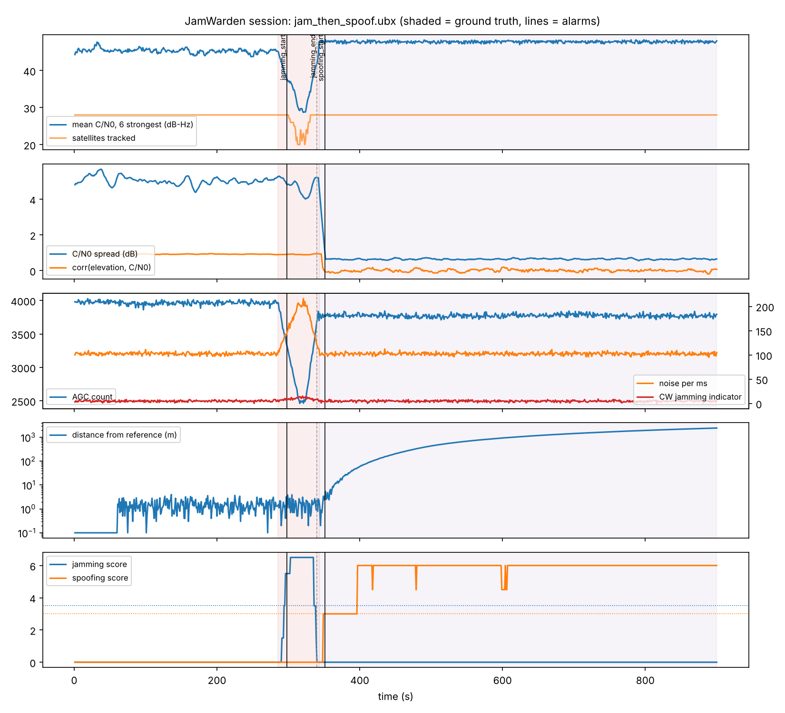
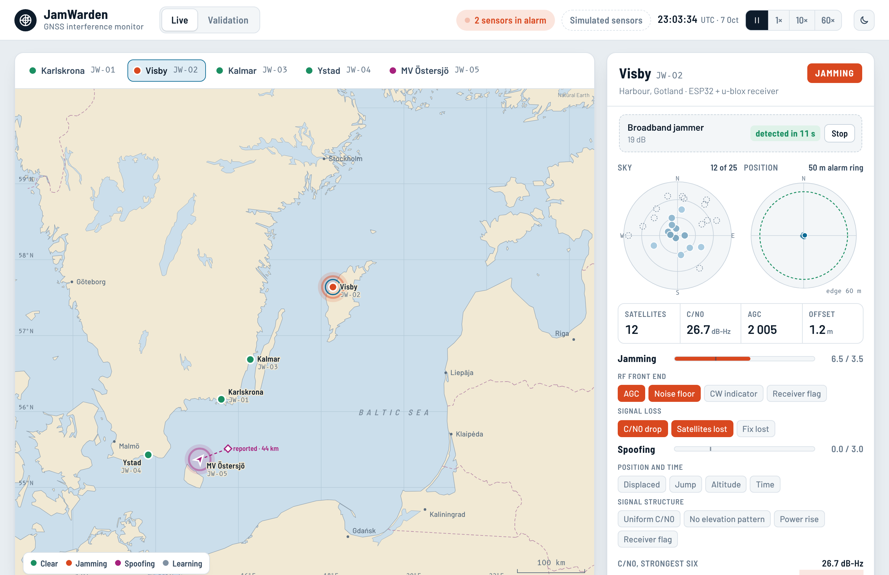

# JamWarden

**A low-cost sensor (ESP32 + u-blox receiver, about 1 000 SEK) that detects GPS/GNSS jamming and spoofing in real
time and puts the alarms on a live map.**

GNSS interference over the Baltic Sea has become a daily problem: aircraft lose GPS, ships report positions
far inland, and the GPS-disciplined clocks used by telecom and power grids are exposed. Commercial interference
monitors are expensive. JamWarden turns a hobby-grade receiver into a monitor by watching **independent
physical indicators**, so the alarm does not depend on the receiver's own (often absent) detection:

| Attack | What JamWarden looks for |
|---|---|
| Jamming | RF front end changes (AGC count, noise floor, CW jamming indicator) **and** signal loss (C/N0 drop, satellites or fix lost). Requiring both separates jamming from a blocked sky. |
| Spoofing | Signal structure (all satellites with the same power, no dependence on elevation, unusually strong), position (static installation displaced, impossible jumps or speed), time (GNSS time shifted against the local clock), and the receiver's own spoof flag when available. |



*A jammer forces re-acquisition (red), then a spoofer takes over and drags the position away (purple). Shaded:
ground truth. Black lines: JamWarden alarms.*

## Live demo

Try it in the browser: **https://varshith2802.github.io/jamwarden/**



A monitoring console for five sensors around the southern Baltic (Karlskrona, Visby, Kalmar, Ystad and a ferry). Pick a
sensor, start a jammer or a spoofer on it and watch the alarm appear with its reasons, the sky plot and the signal
charts; the blocked-sky and multipath tests show that it stays quiet. The Validation tab re-runs the full 280-run
evaluation in the browser and checks it against `eval/results/summary.json`.

The page is [`docs/index.html`](docs/index.html): one file, no server. It contains JavaScript ports of
`tools/scenarios.py` (including Python's random module), the UBX parser, the decoders and the detector. The simulated
streams are byte-identical to the Python simulator, the detector prints exactly the JSON lines of `jamwarden_replay`,
and the evaluation reproduces the published table. Chart data: Natural Earth (public domain).

To publish it from your own copy of the repository: **Settings > Pages > Deploy from a branch > `main` / `docs`**.

## Quick start on a PC (no hardware needed)

Requirements: a C++17 compiler + CMake, Python 3.10+.

```bash
unzip jamwarden.zip && cd jamwarden
pip install -r requirements.txt

cmake -S core -B core/build && cmake --build core/build      # detector library + tools
./core/build/jamwarden_tests                                   # 32 C++ checks
python -m pytest -q tests                                      # 21 Python tests (generator, dashboard, end-to-end)

./core/build/jamwarden_replay --events-only data/scenarios/jam_then_spoof.ubx    # run the detector on a recording
python eval/run_eval.py --seeds 20                             # 280 simulated attacks/negatives -> eval/results/
python tools/plot_session.py data/scenarios/spoof_drag.ubx --out session.png
```

(`make test`, `make eval` and `make plot` do the same on Linux/macOS.)

Live dashboard with a recorded session:

```bash
./core/build/jamwarden_replay data/scenarios/jam_then_spoof.ubx > demo.jsonl
python dashboard/collector.py --file demo.jsonl --db jamwarden.db --no-server
python dashboard/collector.py --db jamwarden.db                # open http://127.0.0.1:8050
```

## Build the sensor

See **[docs/hardware.md](docs/hardware.md)** for parts list, wiring and placement.

```bash
pip install platformio
cd firmware/esp32 && pio run -t upload && pio device monitor     # JSON lines over USB
python ../../dashboard/collector.py --serial /dev/ttyUSB0      # Windows: --serial COM3
```

For Wi-Fi sensors, set the SSID, password and collector URL in `platformio.ini` (`esp32dev-wifi`). Events are
pushed to `POST /api/ingest`, and `GET /api/events.geojson` exports all alarms for sharing or mapping.

The firmware auto-detects the receiver's baud rate, enables NAV-PVT, NAV-SAT, NAV-STATUS, MON-RF (M9/M10)
or MON-HW (M8) and NAV-EOE, switches the link to 115200 baud, and drives an alarm LED/buzzer. The **same
detector code** runs on the board, in the PC replay tool and in the evaluation: `sync_core.py` copies `core/`
into the firmware before each build.

## Results (simulation, 20 random seeds per scenario, 70 simulated hours, 0 false alarms in total)

| Scenario | Attacks | JamWarden | Receiver flags only | Median latency | False alarms |
|---|---|---|---|---|---|
| Broadband jammer 12–25 dB | 20 | **100 %** | 50 % | 12 s | 0 |
| CW jammer | 20 | **100 %** | 35 % | 19 s | 0 |
| Spoofer, drag-off | 20 | **100 %** | 45 % | 8.5 s | 0 |
| Spoofer, 30–80 km jump | 20 | **100 %** | 65 % | 2 s | 0 |
| Time shift 2–10 s | 20 | **100 %** | 55 % | 2 s | 0 |
| Time shift only (no signal change) | 20 | **100 %** | 0 % | 2 s | 0 |
| Jam, then spoof | 40 | **100 %** | 45 % | 10 s | 0 |
| Vessel, position jump (mobile mode) | 20 | **100 %** | 50 % | 2 s | 0 |
| *Hard:* weak jammer 4–8 dB | 20 | 50 % | 0 % | 31.5 s | 0 |
| *Hard:* power-matched spoofer, 0.3 m/s drag | 20 | 100 % | 45 % | **163.5 s** | 0 |
| Clean, obstruction, multipath, moving vessel | 0 | – | – | – | **0 in 20 h** |

"Receiver flags only" is a baseline that uses just the receiver's built-in jamming/spoofing flags. Each run
randomly simulates a receiver with or without them.

**How to read these numbers.** The scenarios come from a physics-inspired simulator (`tools/scenarios.py`)
written alongside the detector, so the evaluation is necessarily optimistic. It shows that the logic works
as designed and where its limits are: weak jammers below about 6 dB, and slow, power-matched spoofers that are
caught only once the position leaves the 50 m radius. Validation on real recordings is the next step:
log UBX from a sensor in the Baltic region and replay it with `jamwarden_replay`.

## How it works

```
u-blox receiver ──UART──► UBX parser ──► per-epoch features ──► baseline (60 s, then slow adaptation while clean)
                                         C/N0 top-6, spread,         │
                                         corr(elev, C/N0), AGC,      ▼
                                         noise, CW ind., position,  indicator rules + weights + hysteresis
                                         speed, time offset          (3 epochs to raise, 5 to clear)
                                                                     ▼
                                                   JSON events/status ──► USB / Wi-Fi ──► collector + map
```

Design choices: the static reference position is never adapted, so a slow drag-off cannot move it. The
time offset against the local clock is adapted only while clean, which tracks the ESP32 crystal drift but not
an attack. One-off position jumps are latched for 5 epochs. NAV-EOE is used for epoch boundaries when
available.

## Repository layout

```
core/            portable C++17 detector (ubx parser, decoders, detector), replay tool, unit tests, CMake
firmware/esp32/  PlatformIO project (Arduino), config.h, host-stub compile check
tools/           scenarios.py (simulator + ground truth), plot_session.py
eval/            run_eval.py -> results/summary.md|json
dashboard/       collector.py (FastAPI + SQLite), index.html (map, charts, events; vendored Leaflet/Chart.js)
data/scenarios/  14 example recordings (.ubx) with ground truth
docs/            index.html (live demo page), hardware.md, figures
report/          report.tex (+ report.pdf)
```

## Limitations

* The evaluation uses simulated data (see above). The firmware was compile-checked against Arduino stubs; the
  GitHub Actions workflow builds it with PlatformIO, but it has not been run on a physical board by the
  author yet.
* Single-antenna detection cannot measure the angle of arrival of signals. Multi-sensor correlation on the
  map (several sensors alarming together) is the planned extension.
* The configuration keys follow the u-blox M8/M9/M10 interface descriptions. Very old M8 firmware may lack
  the NAV-EOE or spoofing flag, and the detector works without them.

## License

MIT © 2026 Varshith. Leaflet (BSD-2-Clause) and Chart.js (MIT) are vendored under `dashboard/static/` with
their licenses.
